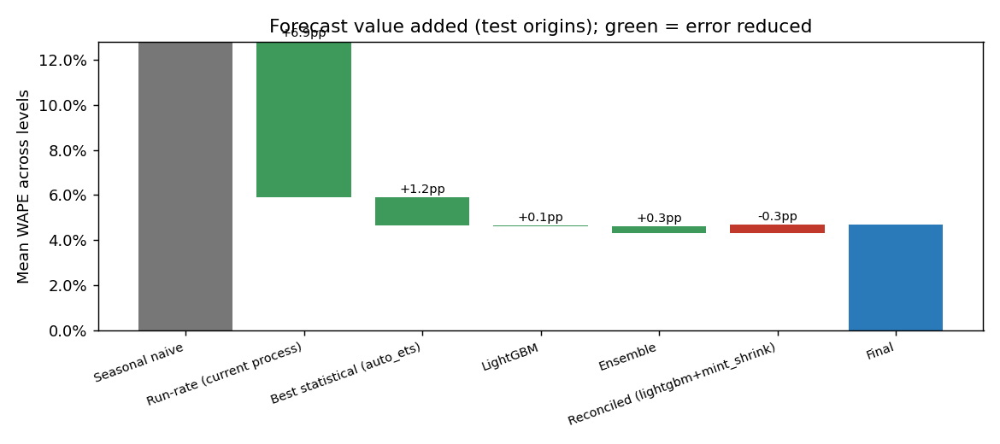
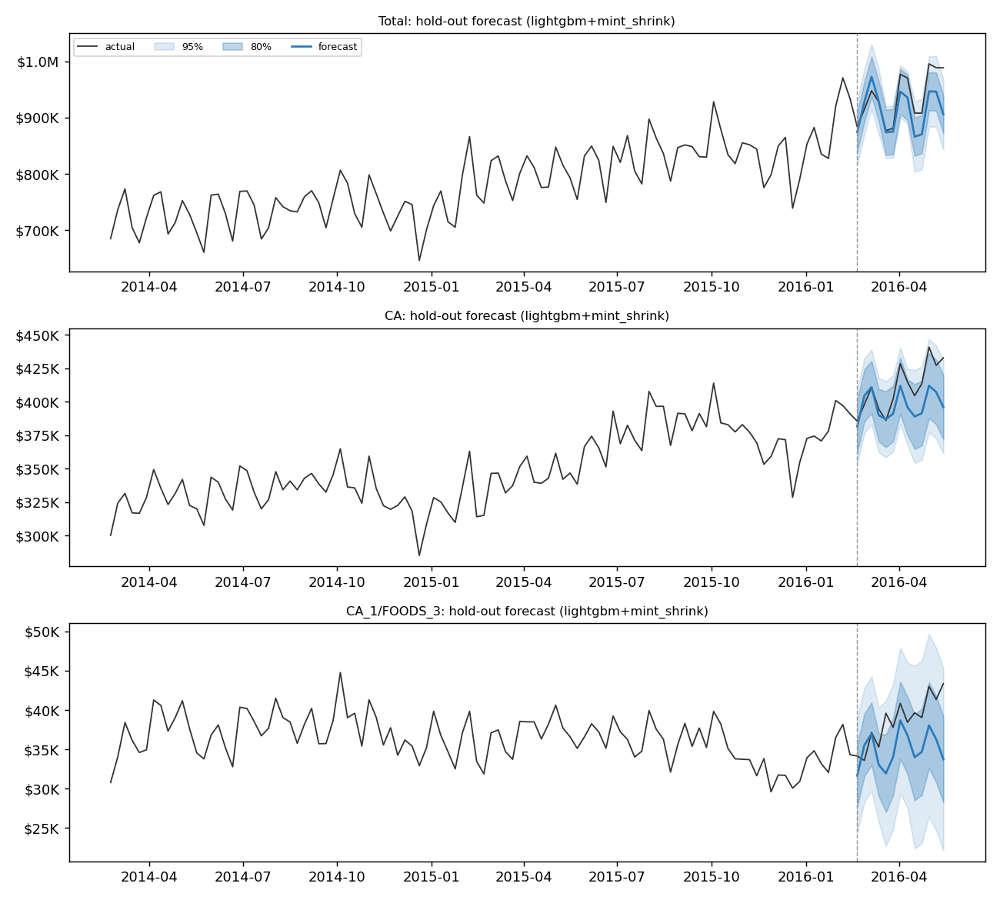
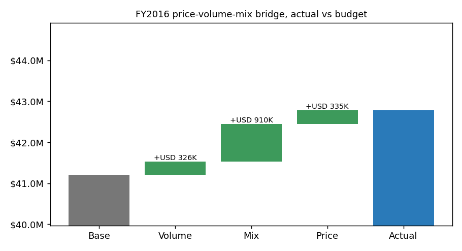
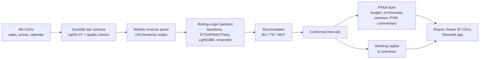

# Retail Revenue Forecasting for FP&A (Walmart M5)

A rolling 13-week revenue forecast for a retail FP&A team: every store and department, with
prediction intervals, budget vs actual vs re-forecast tracking, a price-volume-mix bridge,
and what better forecasts are worth in working capital. Built on the real Walmart M5 data
(10 stores, 2011-2016, USD 191M of revenue).

[](https://github.com/MarKurzeja/fpa-revenue-forecasting/actions/workflows/ci.yml)

## Results

The champion is LightGBM reconciled with MinT (shrinkage), chosen on validation origins
only. Its accuracy is measured on 4 later test origins and a final 13-week hold-out that
was never used for any choice. Full report: [reports/latest/report.md](reports/latest/report.md).

**Store x department (70 series), test + hold-out origins**

| Model | WAPE | Bias | 80% coverage | 95% coverage | WAPE, company total |
|---|---|---|---|---|---|
| **Champion: LightGBM + MinT** | **7.6%** | -0.5% | 79.5% | 94.4% | **2.3%** |
| Run-rate (today's spreadsheet method) | 10.5% | -0.2% | 83.0% | 96.5% | 3.7% |
| Seasonal naive (same week last year) | 15.9% | -12.4% | 82.7% | 94.9% | 12.4% |

**Mean WAPE across all 8 hierarchy levels**

| Model | Test origins | Final hold-out |
|---|---|---|
| Champion: LightGBM + MinT | 4.7% | 5.0% |
| Ensemble (LightGBM, ETS, ARIMA) | 4.3% | 4.8% |
| Run-rate | 5.9% | 6.6% |
| Seasonal naive | 12.8% | 14.9% |

Key findings:
- **Better than today's process at every level.** Against the run-rate method, WAPE falls
  from 10.5% to 7.6% at store x department and from 3.7% to 2.3% for the company total.
  The gain over seasonal naive is significant (Diebold-Mariano p < 0.0001).
- **Seasonal naive flatters the comparison.** Revenue grew year on year, so "same week
  last year" under-forecasts by 12%. The fair benchmark is run-rate: it is 1.2 points
  behind the champion on mean WAPE across levels (5.9% vs 4.7%).
- **The intervals are honest.** The champion's 80% and 95% intervals cover 79.5% and 94.4%
  of actuals. The statistical models' own intervals are too narrow (AutoETS: 71% and 89%).
- **Forecasts add up.** After MinT reconciliation every parent equals the sum of its
  children, and accuracy at the company level improves (2.7% to 2.3% WAPE).
- **FY2016 came in USD 1.57M (+3.8%) above budget.** Actual revenue was USD 42.78M against
  a frozen budget of USD 41.21M. The re-forecasts saw the gap early: the full-year outlook
  was already +2.2% above budget after one month and settled at +3.5% by month 12.
- **USD 54K less safety stock** at a 95% service level than with run-rate forecasts, a 32%
  reduction, worth about USD 11K a year in carrying cost. This is a stylised simulation;
  see the limitations.
- **The ensemble was slightly better after the fact** (4.3% vs 4.7% on test), but it lost
  on the validation origins, so it was not chosen. That is the price of an honest
  selection process.

## Charts

Forecast value added: how each step changes mean WAPE vs seasonal naive and run-rate.



Hold-out forecasts with 80% and 95% intervals: company total, a state, and one store x
department.



FY2016 revenue vs budget, split into price, volume and mix.



## The business problem

> How much revenue will each store and department make over the next quarter, how sure are
> we, why are we off budget, and how much inventory cash can a better forecast free up?

A finance team needs four things:
- a **rolling forecast** in USD that adds up from department to company;
- honest ranges around it;
- an explanation of variances vs budget and last year (**price, volume, mix**);
- a way to show that forecast accuracy has a cash value.

## How it works



## Data

[M5 Forecasting - Accuracy](https://www.kaggle.com/competitions/m5-forecasting-accuracy/data)
is Walmart's daily unit sales for 3,049 items in 10 stores (CA, TX, WI) from 2011-01-29 to
2016-05-22: 30,490 item x store series, 3 categories and 7 departments. Weekly sell prices
and a calendar of events and SNAP days come with it. All of these facts were checked
against the loaded data ([docs/DATA_FACTS.md](docs/DATA_FACTS.md)).

- **Revenue** = units x that week's price, summed to Walmart weeks (Saturday to Friday) and
  to store x department. That gives 70 bottom series over 277 full weeks.
- Days before an item's first price count as "not listed", not as zero demand.
- The final partial week (2 days) is dropped.

**Licence:** the data is subject to the
[Kaggle competition rules](https://www.kaggle.com/competitions/m5-forecasting-accuracy/rules)
and is **not** included in this repository. Accept the rules on Kaggle, then run
`python run.py download`.

## Method

Full details are in [docs/METHODOLOGY.md](docs/METHODOLOGY.md), and design choices in
[docs/DECISIONS.md](docs/DECISIONS.md).

- **Hierarchy:** 8 levels and 133 nodes, from company down to store x department.
- **Backtesting:** 8 rolling origins, 4 weeks apart, each forecasting 13 weeks, with an
  expanding window. The first 4 are for validation (selection, tuning, interval
  calibration) and the last 4 are test. A final 13-week hold-out is never used for any
  choice.
- **Models:**
  - Baselines: naive, seasonal naive, 4- and 13-week moving averages, and run-rate x
    seasonality index (today's spreadsheet process).
  - Statistical: AutoETS (on STL-adjusted data), AutoARIMA with Fourier terms, AutoTheta.
  - A global direct multi-horizon LightGBM across all 133 nodes, and an average of the
    top 3 models.
- **Intervals:** 80% and 95%. Statistical models use their native intervals; the rest are
  split-conformal, calibrated per level and horizon on validation origins.
- **Reconciliation:** bottom-up, top-down (forecast proportions) and MinT (OLS and shrink),
  compared at every level.
- **Metrics:** WAPE (primary), bias, MAE, RMSE, MASE, revenue-weighted RMSSE, coverage,
  pinball and Winkler scores. FVA vs seasonal naive and run-rate, and a Diebold-Mariano test.

**Not comparable with the Kaggle leaderboard.** M5 scored daily *unit* forecasts for every
item x store with WRMSSE. This project forecasts weekly *revenue* at store x department,
which is a smoother target and a different metric.

## FP&A results (FY2016: Feb 2015 to Jan 2016)

- **Budget:** a 12-month forecast frozen at the start of the year (USD 41.21M).
- **Re-forecasts:** made at the start of each later fiscal month.
- **Variance tables:** month, quarter and YTD for all 133 nodes. Actuals beat budget in
  every month, by 1.0% to 7.3%.
- **Budget-gap tracking:** the full-year outlook moved from +2.2% (month 2) to +3.5%
  (month 12) above budget.
- **Price-volume-mix bridge:** built from item-level data, vs prior year and vs budget.
  The effects sum exactly to the variance.
- **Template commentary** for each fiscal month, for example:

  > Fiscal month 7 (FY2016) revenue was USD 3.4M, 5.4% above budget (+USD 174K). Volume
  > explains +USD 154K, mostly HOUSEHOLD in CA. Price added USD 26K, mostly FOODS in CA.
  > The full-year outlook is now 2.7% above budget, down from 3.7% above last month.

**Working capital** (lead time 2 weeks, safety stock at cost):

| Service level | Champion | Run-rate | Seasonal naive | Released vs run-rate | Carrying cost saved / yr |
|---|---|---|---|---|---|
| 90% | USD 90K | USD 132K | USD 108K | USD 42K | USD 8K |
| 95% | USD 116K | USD 169K | USD 138K | USD 54K | USD 11K |
| 98% | USD 144K | USD 212K | USD 173K | USD 67K | USD 13K |

## Limitations

- **No real costs.** COGS ratios (FOODS 75%, HOBBIES 60%, HOUSEHOLD 65%), the 20%
  carrying-cost rate and the 2-week lead time are documented assumptions in `config.yaml`.
- **Working capital is revenue-level.** It is a stylised store x department simulation;
  real safety stock is set per item in units. The absolute USD is small because M5 covers
  only a sample of each store's range. Read the 32% relative reduction rather than the
  dollar amount. On the hold-out, the champion's buffer met demand in 90% of lead-time
  windows against a 95% target, so its safety stock is slightly too lean.
- **Elasticities are not usable as estimated.** The regression gives positive price
  elasticities for FOODS and HOUSEHOLD. Prices and demand both rose over time and around
  promotions, so the observational estimates pick up that confounding rather than the
  price effect. The price scenarios in the report should not be read as forecasts.
- **Weakest segments.** HOBBIES_2 (small revenue, volatile) has the worst series, and
  HOBBIES intervals under-cover (67% at the 80% level). Wisconsin is the least accurate
  state (8.8% WAPE, -3.2% bias).
- **Data period 2011-2016.** It's one retailer's 10 stores, with no recent macro shocks.
  The budget is a simulated frozen forecast, not a management plan.

## How to run

Python 3.11 or 3.12.

```bash
python3.12 -m venv .venv && source .venv/bin/activate
pip install -r requirements.txt
# macOS: build LightGBM without OpenMP (requires working Xcode Command Line Tools)
bash scripts/install_lightgbm_no_openmp.sh

python run.py download        # M5 via Kaggle CLI (or unzip manually into data/raw/)
python run.py all             # build -> backtest -> reconcile -> plan -> capital -> report -> export
python run.py app             # Streamlit app on the exported artefacts
python run.py check           # lint + tests + quick real-data run (3 stores) with quality gates
```

| Command | What it does |
|---|---|
| `build` | DuckDB star schema from the CSVs, data-quality checks, `docs/DATA_FACTS.md` |
| `backtest [--models all\|baselines\|stats\|ml] [--origins N]` | Rolling-origin backtest, tuning, ensemble, reconciliation, intervals |
| `reconcile` | Per-level comparison and coherence check |
| `plan` | Budget, re-forecasts, variance, PVM, commentary |
| `capital` | Working capital, service-level check, elasticities, scenarios |
| `report` | `reports/latest/report.md` and figures |
| `export` | Power BI CSVs (`exports/powerbi/`, see [docs/POWERBI.md](docs/POWERBI.md)) and app artefacts |

Each step prints its runtime and caches its results.
- `--force` recomputes cached results.
- `--quick` runs on the 3-store subset.
- `-v` shows progress logs.

## Structure

```
sql/            versioned DuckDB build (01-07) and data-quality checks
src/fpa/        config, fiscal calendar, hierarchy, features, models/, backtest, reconcile,
                metrics, evaluate, planning, pvm, commentary, working_capital, elasticity,
                report, export, pipeline
app/            Streamlit app
docs/           METHODOLOGY, DECISIONS, POWERBI, DATA_FACTS (generated)
reports/        generated report and figures
tests/          unit tests (hand-built fixtures; DuckDB/statsforecast/LightGBM tests run when installed)
```

## Skills demonstrated

| Area | Techniques |
| --- | --- |
| SQL | DuckDB star schema, UNPIVOT of a 1,941-column matrix, CTEs, window functions, filtered aggregates, Laspeyres index in SQL, data-quality checks that fail the build |
| Python | pandas/numpy pipeline, typed config, caching, CLI, matplotlib/plotly |
| Time-series forecasting | Rolling-origin backtesting, seasonal baselines, ETS/ARIMA/Theta, hierarchical reconciliation (MinT shrinkage) |
| ML | Global LightGBM, direct multi-horizon strategy, leakage tests, target transforms, validation-only tuning |
| Statistics | Conformal prediction intervals, Diebold-Mariano test, log-log elasticity regression |
| FP&A | Rolling forecast, budget vs actual vs latest estimate, price-volume-mix bridge, FVA, working capital |
| Power BI | Star schema exports, DAX measures (YTD, outlook, variance) |
| Testing & CI | pytest (coverage gate), ruff, GitHub Actions |

## License

MIT for the code (see `LICENSE`). The M5 data is under the Kaggle competition rules and is
not distributed here.
