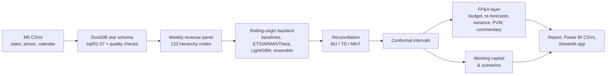

# Retail Revenue Forecasting for FP&A (Walmart M5)

A rolling 13-week revenue forecast for a retail FP&A team: every store and department, with
prediction intervals, budget vs actual vs re-forecast tracking, a price-volume-mix bridge,
and what better forecasts are worth in working capital. Built on the real Walmart M5 data.

[](https://github.com/MarKurzeja/fpa-revenue-forecasting/actions/workflows/ci.yml)
**Live demo:** _add the Streamlit Community Cloud link after deploying (see [D-12](docs/DECISIONS.md))._

## Results

> **Not yet filled in.** Every number in this section comes from
> `reports/latest/report.md`, which `python run.py all` generates on the real M5 data.
> Copy the figures across after the run; none are estimated here.

| Model | WAPE (store x dept) | Bias | 80% coverage | 95% coverage |
|---|---|---|---|---|
| Champion (`selection.json` -> `champion`) | _from report §1_ | | | |
| Run-rate (today's spreadsheet method) | | | | |
| Seasonal naive (benchmark) | | | | |

Key findings, from report §8 and the FP&A and working-capital sections:
- _WAPE cut from X% (seasonal naive) / Y% (run-rate) to Z% across N backtest origins._
- _Forecasts reconciled across the 8-level hierarchy with method M; coherent at every level._
- _FYyyyy revenue vs budget: +/-X%, with the price-volume-mix split._
- _USD X of safety-stock working capital released at a 95% service level (stylised)._

## Screenshots

_Add `images/app.png` (Streamlit) and `images/powerbi.png` (from `powerbi/fpa_dashboard.pdf`)._

## The business problem

> How much revenue will each store and department make over the next quarter, how sure are
> we, why are we off budget, and how much inventory cash can a better forecast free up?

A finance team needs a **rolling forecast** in USD that adds up from department to company,
honest ranges around it, an explanation of variances vs budget and last year (**price,
volume, mix**), and a way to show that forecast accuracy has a cash value.

## How it works



## Data

[M5 Forecasting - Accuracy](https://www.kaggle.com/competitions/m5-forecasting-accuracy/data)
is daily unit sales for 3,049 Walmart items in 10 stores (CA, TX, WI) from 2011 to 2016,
with weekly sell prices and a calendar of events and SNAP days. These facts are from
SPEC §2.1 and are verified on load: `python run.py build` writes `docs/DATA_FACTS.md`.

- **Revenue** = units x that week's price, summed to Walmart weeks (Saturday to Friday)
  and to store x department.
- Days before an item's first price count as "not listed", not as zero demand.
- Partial weeks are dropped.

**Licence:** the data is subject to the
[Kaggle competition rules](https://www.kaggle.com/competitions/m5-forecasting-accuracy/rules)
and is **not** included in this repository. Accept the rules on Kaggle, then:

```bash
python run.py download   # needs ~/.kaggle/kaggle.json; prints manual steps if it fails
```

## Method

Full details are in [docs/METHODOLOGY.md](docs/METHODOLOGY.md), and design choices in
[docs/DECISIONS.md](docs/DECISIONS.md).

- **Backtesting:** 8 rolling origins, 4 weeks apart, each forecasting 13 weeks, with an
  expanding window. The first 4 are validation (selection, tuning, interval calibration)
  and the last 4 are test. A final 13-week hold-out is never used for any choice.
- **Models:**
  - Baselines: naive, seasonal naive, 4- and 13-week moving averages, and run-rate x
    seasonality index (today's spreadsheet process).
  - Statistical: AutoETS (on STL-adjusted data), AutoARIMA with Fourier terms, AutoTheta.
  - A global direct multi-horizon LightGBM, and an average of the top 3 models.
- **Intervals:** 80% and 95%. Statistical models use their native intervals; the rest are
  split-conformal, calibrated per level and horizon on validation origins.
- **Reconciliation:** bottom-up, top-down (forecast proportions) and MinT (OLS and shrink),
  compared at every level. Coherence is tested.
- **Metrics:** WAPE (primary), bias, MAE, RMSE, MASE, revenue-weighted RMSSE, coverage,
  pinball and Winkler scores. FVA vs seasonal naive and run-rate, and a Diebold-Mariano test.

## FP&A results

Generated by `python run.py plan`:
- The **budget** is a 12-month forecast frozen at the start of the last full fiscal year.
- **Re-forecasts** are made at the start of each later fiscal month.
- **Variance tables** cover month, quarter and YTD for every node, plus
  **budget-gap tracking** of the full-year outlook.
- The **price-volume-mix bridge** is computed from item-level data, against prior year and
  against budget. The effects sum exactly to the variance.
- **Template commentary** is generated for each fiscal month.

`python run.py capital` estimates the working capital released by better forecasts:
safety stock at 90/95/98% service levels vs seasonal naive and run-rate, with a hold-out
check of the achieved service level. It also estimates per-category price elasticities and
event uplifts. _Charts: `reports/figures/pvm_*.png` and report sections "FP&A" and
"Working capital"._

## Limitations

- **No real costs.** COGS ratios, the carrying-cost rate and the lead time are documented
  assumptions in `config.yaml`.
- **Working capital is revenue-level.** It is a stylised store x department simulation;
  real safety stock is set per item in units. Use the relative comparison between methods,
  not the absolute USD.
- **Elasticities are observational.** Prices move with promotions and seasons, so the
  coefficients are associations, not causal effects.
- **Data period 2011-2016.** It's one retailer's 10 stores, with no macro shocks of recent
  years. The budget is simulated (a frozen forecast), not a management plan.

## How to run

Python 3.11 or 3.12.

```bash
python3.11 -m venv .venv && source .venv/bin/activate
pip install -r requirements.txt
# macOS: build LightGBM without OpenMP (requires working Xcode Command Line Tools)
bash scripts/install_lightgbm_no_openmp.sh

python run.py download        # M5 via Kaggle CLI (or unzip manually into data/raw/)
python run.py all             # build -> backtest -> reconcile -> plan -> capital -> report -> export
python run.py app             # Streamlit app on the exported artefacts
python run.py check           # lint + tests + quick real-data run (3 stores) with quality gates
```

| Command | What it does |
|---|---|
| `build` | DuckDB star schema from the CSVs, data-quality checks, `docs/DATA_FACTS.md` |
| `backtest [--models all\|baselines\|stats\|ml] [--origins N]` | Rolling-origin backtest, tuning, ensemble, reconciliation, intervals |
| `reconcile` | Per-level comparison and coherence check |
| `plan` | Budget, re-forecasts, variance, PVM, commentary |
| `capital` | Working capital, service-level check, elasticities, scenarios |
| `report` | `reports/latest/report.md` and figures |
| `export` | Power BI CSVs (`exports/powerbi/`, see [docs/POWERBI.md](docs/POWERBI.md)) and app artefacts |

Each step prints its runtime and caches results; use `--force` to recompute, `--quick`
for the 3-store subset, and `-v` for progress logs. _Record the full-run runtime and peak
memory on your laptop here._

## Structure

```
sql/            versioned DuckDB build (01-07) and data-quality checks
src/fpa/        config, fiscal calendar, hierarchy, features, models/, backtest, reconcile,
                metrics, evaluate, planning, pvm, commentary, working_capital, elasticity,
                report, export, pipeline
app/            Streamlit app
docs/           METHODOLOGY, DECISIONS, POWERBI, DATA_FACTS (generated)
tests/          unit tests (hand-built fixtures; DuckDB/statsforecast/LightGBM tests run when installed)
```

## Skills demonstrated

| Area | Techniques |
| --- | --- |
| SQL | DuckDB star schema, UNPIVOT of a 1,941-column matrix, CTEs, window functions, filtered aggregates, Laspeyres index in SQL, data-quality checks that fail the build |
| Python | pandas/numpy pipeline, typed config, caching, CLI, matplotlib/plotly |
| Time-series forecasting | Rolling-origin backtesting, seasonal baselines, ETS/ARIMA/Theta, hierarchical reconciliation (MinT shrinkage) |
| ML | Global LightGBM, direct multi-horizon strategy, leakage tests, target transforms, validation-only tuning |
| Statistics | Conformal prediction intervals, Diebold-Mariano test, log-log elasticity regression |
| FP&A | Rolling forecast, budget vs actual vs latest estimate, price-volume-mix bridge, FVA, working capital |
| Power BI | Star schema exports, DAX measures (YTD, outlook, variance) |
| Testing & CI | pytest (coverage gate), ruff, GitHub Actions |

## License

MIT for the code (see `LICENSE`). The M5 data is under the Kaggle competition rules and is
not distributed here.
