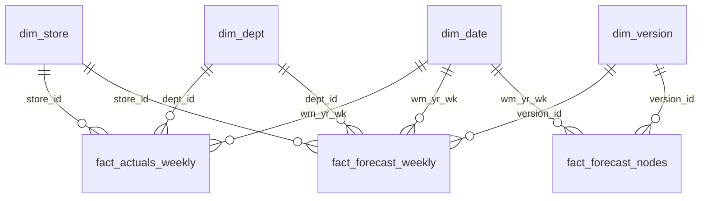

# Power BI guide

`python run.py export` writes these CSVs to `exports/powerbi/`. Build the `.pbix` from
them with **Get data > Text/CSV**, then set up the relationships and measures below.

## Data model



| Table | Grain | Key columns |
|---|---|---|
| dim_date | Walmart week (actual and projected) | wm_yr_wk, week_start, fiscal_year, fiscal_quarter, fiscal_month, fiscal_period, is_actual |
| dim_store | store | store_id, state_id |
| dim_dept | department | dept_id, cat_id |
| dim_version | forecast version | version_id, type (budget / reforecast / rolling), created_at, fiscal_month_created |
| fact_actuals_weekly | week x store x dept | revenue, units, price_index |
| fact_forecast_weekly | version x week x store x dept | revenue_point (additive), lo80/hi80/lo95/hi95 (**not additive**) |
| fact_forecast_nodes | version x week x hierarchy node | point and intervals for every level (use for interval visuals at aggregate levels) |
| fact_metrics | model x family x role x level x horizon bucket | wape, bias, mae, rmse, coverage80/95, widths |
| fact_pvm | comparison x fiscal month x store x dept | base, volume, mix, price, actual, variance (fiscal_month 0 = full year) |
| fact_variance_monthly | fiscal month x node | actual, budget, latest_forecast, variances |
| fact_commentary | fiscal month | generated text |

**Relationships** (all single-direction, one-to-many, from dimension to fact):
- `dim_date[wm_yr_wk]` to `fact_actuals_weekly`, `fact_forecast_weekly` and `fact_forecast_nodes`.
- `dim_store[store_id]` and `dim_dept[dept_id]` to `fact_actuals_weekly` and `fact_forecast_weekly`.
- `dim_version[version_id]` to `fact_forecast_weekly` and `fact_forecast_nodes`.

`fact_metrics`, `fact_pvm`, `fact_variance_monthly` and `fact_commentary` are standalone
tables; slice them with their own columns. Mark `dim_date` as the date table, using
`week_start`.

## DAX measures

```DAX
Actual = SUM ( fact_actuals_weekly[revenue] )

Budget =
CALCULATE (
    SUM ( fact_forecast_weekly[revenue_point] ),
    dim_version[type] = "budget"
)

-- Forecast made at the start of each fiscal month for that month (the "latest estimate").
Latest Forecast =
SUMX (
    VALUES ( dim_date[fiscal_month] ),
    VAR m = dim_date[fiscal_month]
    VAR v =
        CALCULATE (
            MAX ( dim_version[version_id] ),
            dim_version[type] IN { "budget", "reforecast" },
            dim_version[fiscal_month_created] = m,
            REMOVEFILTERS ( dim_date )
        )
    RETURN
        CALCULATE (
            SUM ( fact_forecast_weekly[revenue_point] ),
            dim_version[version_id] = v
        )
)

Var vs Budget = [Actual] - [Budget]

Var % = DIVIDE ( [Var vs Budget], [Budget] )

Var vs Latest = [Actual] - [Latest Forecast]

Actual YTD =
CALCULATE (
    [Actual],
    FILTER (
        ALL ( dim_date ),
        dim_date[fiscal_year] = MAX ( dim_date[fiscal_year] )
            && dim_date[week_start] <= MAX ( dim_date[week_start] )
    )
)

Budget YTD =
CALCULATE (
    [Budget],
    FILTER (
        ALL ( dim_date ),
        dim_date[fiscal_year] = MAX ( dim_date[fiscal_year] )
            && dim_date[week_start] <= MAX ( dim_date[week_start] )
    )
)

-- Full-year outlook for the version selected in a slicer on dim_version:
-- actuals before the version's origin + that version's forecast after it.
Full-Year Outlook =
VAR v = SELECTEDVALUE ( dim_version[version_id] )
VAR fy = SELECTEDVALUE ( dim_version[fiscal_year] )
VAR created = SELECTEDVALUE ( dim_version[created_at] )
RETURN
    CALCULATE (
        [Actual],
        dim_date[fiscal_year] = fy,
        dim_date[week_start] < created
    )
        + CALCULATE (
            SUM ( fact_forecast_weekly[revenue_point] ),
            dim_version[version_id] = v,
            dim_date[fiscal_year] = fy,
            dim_date[week_start] >= created
        )

Outlook Gap vs Budget % =
VAR fy = SELECTEDVALUE ( dim_version[fiscal_year] )
VAR bud =
    CALCULATE (
        SUM ( fact_forecast_weekly[revenue_point] ),
        dim_version[type] = "budget",
        dim_date[fiscal_year] = fy,
        REMOVEFILTERS ( dim_version[version_id] )
    )
RETURN
    DIVIDE ( [Full-Year Outlook] - bud, bud )

-- Accuracy (filter fact_metrics by model, role = "test" or "holdout", level).
WAPE = AVERAGE ( fact_metrics[wape] )
Bias = AVERAGE ( fact_metrics[bias] )
Coverage 80 = AVERAGE ( fact_metrics[coverage80] )
Coverage 95 = AVERAGE ( fact_metrics[coverage95] )
```

For exact pooled WAPE across several metric rows, weight by actuals:
`DIVIDE ( SUMX ( fact_metrics, fact_metrics[wape] * fact_metrics[actual_usd] ), SUM ( fact_metrics[actual_usd] ) )`.

## Suggested pages

1. **Overview**: KPI cards (Actual YTD, Budget YTD, Var %, Full-Year Outlook), with a
   monthly Actual vs Budget vs Latest Forecast column chart.
2. **Variance**: a matrix of state > store x category > department with Var vs Budget and
   Var %, plus conditional formatting (green / red).
3. **Bridge**: a waterfall from `fact_pvm` (base, volume, mix, price, actual) with slicers
   for comparison and fiscal month.
4. **Forecast**: a line chart of actuals plus the rolling version, with `fact_forecast_nodes`
   bands for the selected node.
5. **Accuracy**: WAPE by model and level from `fact_metrics`, and an FVA bar chart.

Export the finished report to `powerbi/fpa_dashboard.pdf` for the README.
