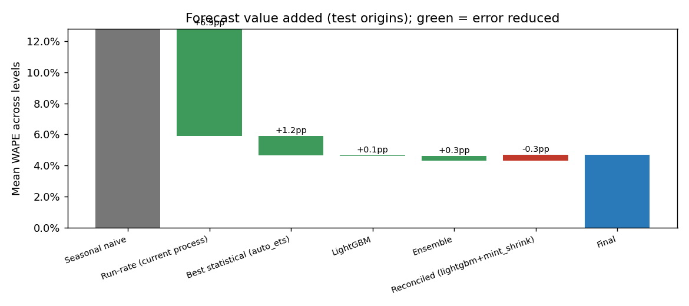
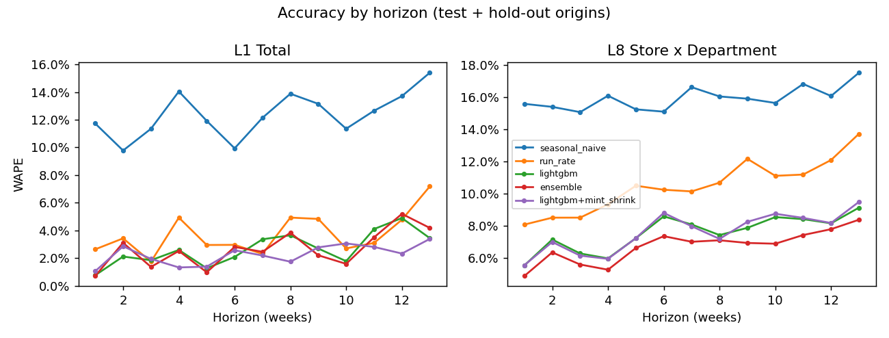
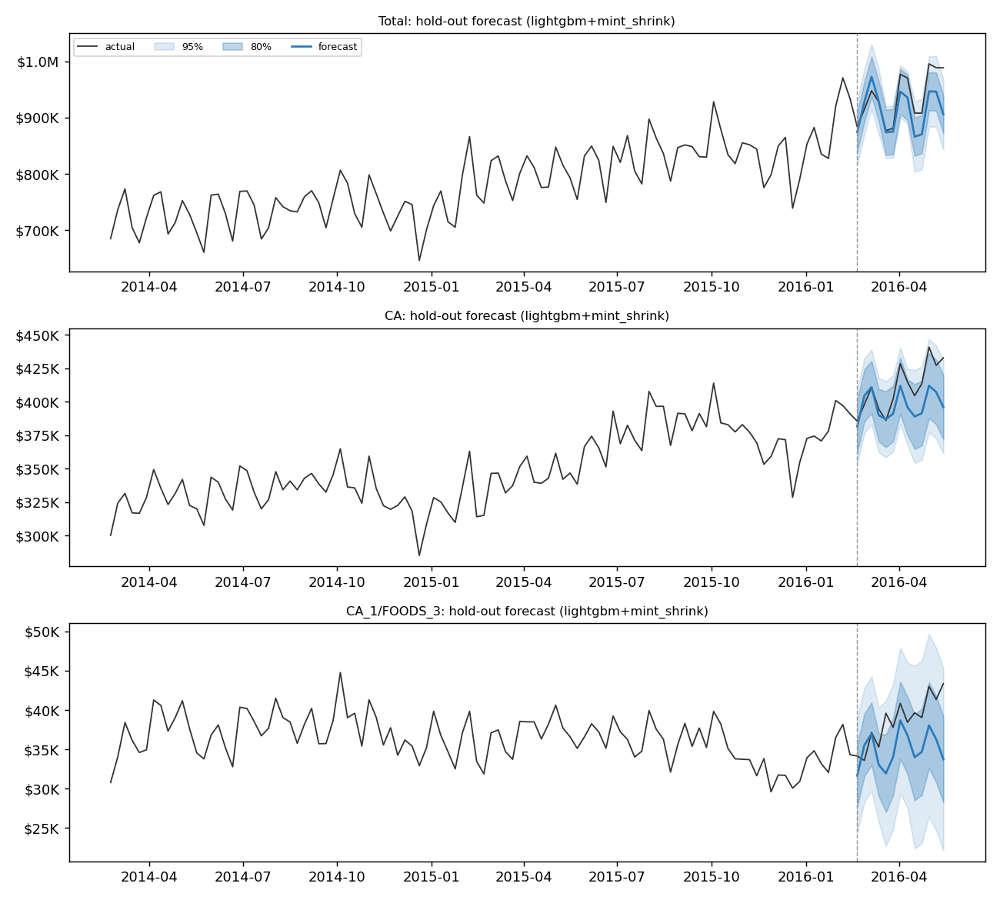
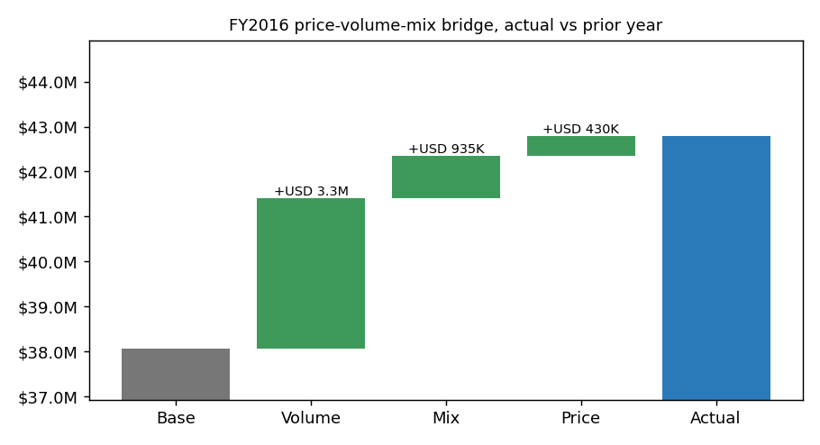
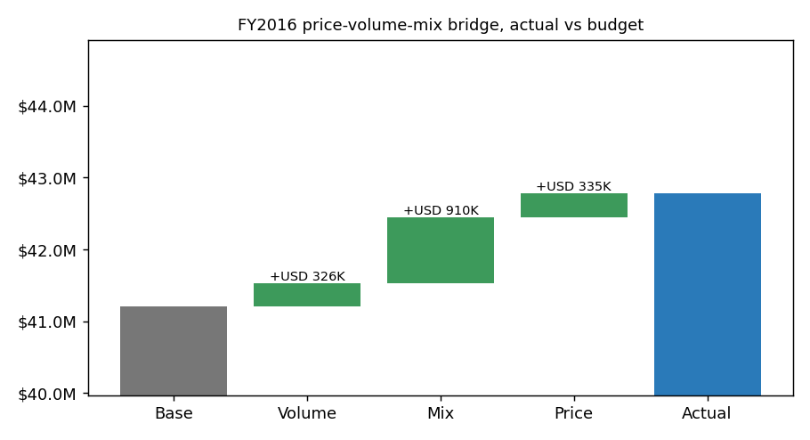

# Revenue forecasting report

Data: 70 store x department series, 277 full Walmart weeks (2011-01-29 to 2016-05-20), total revenue USD 191.2M.
Backtest origins (week index): validation [223, 227, 231, 235], test [239, 243, 247, 251], hold-out 264. Horizon 13 weeks.
Champion (chosen on validation origins only): **lightgbm+mint_shrink**.

## 1. Headline: WAPE by model and hierarchy level (test origins)

| model | L1 | L2 | L3 | L4 | L5 | L6 | L7 | L8 | mean |
|---|---|---|---|---|---|---|---|---|---|
| ensemble | 2.5% | 2.8% | 4.0% | 3.9% | 4.7% | 4.4% | 5.6% | 6.7% | 4.3% |
| lightgbm | 2.4% | 2.8% | 4.7% | 3.9% | 4.9% | 4.3% | 6.1% | 7.7% | 4.6% |
| auto_ets | 2.5% | 3.0% | 4.4% | 4.1% | 5.1% | 4.7% | 6.2% | 7.2% | 4.7% |
| lightgbm+mint_shrink | 2.0% | 2.8% | 4.6% | 4.0% | 5.0% | 4.8% | 6.4% | 7.7% | 4.7% |
| auto_arima | 3.4% | 3.9% | 4.4% | 4.8% | 5.5% | 5.2% | 6.0% | 7.3% | 5.0% |
| run_rate | 3.6% | 3.8% | 5.9% | 4.8% | 5.3% | 5.3% | 7.7% | 10.7% | 5.9% |
| auto_theta | 4.3% | 5.8% | 6.4% | 6.0% | 7.5% | 7.2% | 8.1% | 9.2% | 6.8% |
| ma4 | 4.4% | 5.7% | 6.3% | 6.1% | 7.3% | 7.1% | 8.0% | 9.5% | 6.8% |
| ma13 | 4.3% | 5.7% | 6.7% | 5.9% | 7.4% | 7.0% | 8.3% | 10.0% | 6.9% |
| naive | 5.3% | 6.7% | 7.1% | 6.9% | 8.1% | 8.2% | 9.0% | 10.6% | 7.7% |
| seasonal_naive | 11.8% | 11.8% | 12.1% | 11.8% | 12.8% | 12.0% | 14.2% | 15.9% | 12.8% |

Bottom level (store x department) and company total, test + hold-out origins:

| model | wape | bias | mase | wrmsse | coverage80 | coverage95 | wape_total | bias_total |
|---|---|---|---|---|---|---|---|---|
| ensemble | 6.7% | -1.3% | 0.568 | 0.984 | 83.3% | 95.3% | 2.7% | -1.8% |
| auto_arima | 7.2% | -2.3% | 0.624 | 1.057 | 74.8% | 90.1% | 3.4% | -2.3% |
| auto_ets | 7.3% | -1.1% | 0.603 | 1.042 | 71.3% | 88.7% | 2.8% | -0.7% |
| lightgbm | 7.6% | -0.6% | 0.641 | 1.091 | 80.4% | 94.4% | 2.7% | -2.5% |
| lightgbm+mint_shrink | 7.6% | -0.5% | 0.646 | 1.101 | 79.5% | 94.4% | 2.3% | -0.5% |
| auto_theta | 9.1% | 0.6% | 0.733 | 1.272 | 73.6% | 88.9% | 4.4% | -0.0% |
| ma4 | 9.3% | 0.4% | 0.764 | 1.277 | 78.2% | 94.4% | 4.4% | 0.4% |
| naive | 10.3% | -1.5% | 0.837 | 1.370 | 81.1% | 93.9% | 5.0% | -1.5% |
| ma13 | 10.3% | -2.0% | 0.839 | 1.416 | 75.5% | 94.9% | 5.4% | -2.0% |
| run_rate | 10.5% | -0.2% | 0.764 | 1.506 | 83.0% | 96.5% | 3.7% | -2.7% |
| seasonal_naive | 15.9% | -12.4% | 1.209 | 2.291 | 82.7% | 94.9% | 12.4% | -12.4% |

### Final hold-out (last 13 weeks, never used for selection)

| model | L1 | L2 | L3 | L4 | L5 | L6 | L7 | L8 | mean |
|---|---|---|---|---|---|---|---|---|---|
| ensemble | 3.5% | 3.9% | 4.5% | 4.1% | 4.7% | 5.1% | 5.9% | 6.8% | 4.8% |
| auto_arima | 3.5% | 4.3% | 4.7% | 4.0% | 4.5% | 5.1% | 6.0% | 7.0% | 4.9% |
| lightgbm+mint_shrink | 3.1% | 3.9% | 4.7% | 4.3% | 5.0% | 5.2% | 6.2% | 7.4% | 5.0% |
| lightgbm | 3.8% | 4.0% | 4.8% | 4.6% | 5.3% | 5.5% | 6.2% | 7.1% | 5.2% |
| auto_ets | 3.6% | 4.3% | 5.0% | 4.4% | 5.2% | 5.4% | 6.7% | 7.7% | 5.3% |
| ma4 | 4.2% | 5.0% | 5.6% | 5.1% | 6.3% | 6.2% | 7.3% | 8.5% | 6.0% |
| naive | 4.1% | 5.4% | 5.9% | 4.9% | 5.7% | 6.5% | 7.6% | 9.0% | 6.1% |
| auto_theta | 4.8% | 5.3% | 5.8% | 5.7% | 6.4% | 6.6% | 7.4% | 8.5% | 6.3% |
| run_rate | 4.2% | 4.9% | 5.9% | 6.0% | 6.7% | 7.1% | 8.3% | 9.5% | 6.6% |
| ma13 | 9.3% | 9.3% | 9.7% | 9.3% | 10.4% | 9.8% | 10.3% | 11.4% | 9.9% |
| seasonal_naive | 14.6% | 14.6% | 14.7% | 14.6% | 14.6% | 14.9% | 15.2% | 15.9% | 14.9% |

## 2. Forecast value added

| step | mean_wape | fva_vs_seasonal_naive_pp | fva_vs_run_rate_pp |
|---|---|---|---|
| Seasonal naive | 12.81% | +0.00 | -6.92 |
| Run-rate (current process) | 5.89% | +6.92 | +0.00 |
| Best statistical (auto_ets) | 4.65% | +8.16 | +1.23 |
| LightGBM | 4.60% | +8.21 | +1.29 |
| Ensemble | 4.32% | +8.49 | +1.57 |
| Reconciled (lightgbm+mint_shrink) | 4.67% | +8.14 | +1.22 |

## 3. Accuracy by horizon

WAPE pooled over all levels:

| model | 1-4 | 5-8 | 9-13 |
|---|---|---|---|
| ensemble | 3.5% | 4.5% | 5.1% |
| lightgbm | 3.8% | 4.8% | 5.5% |
| lightgbm+mint_shrink | 3.8% | 4.7% | 5.5% |
| run_rate | 5.2% | 5.9% | 6.8% |
| seasonal_naive | 12.7% | 12.9% | 14.0% |

## 4. Example forecasts with 80% / 95% intervals (hold-out)

## 5. Reconciliation: WAPE per level before and after (test + hold-out)

| level | lightgbm | lightgbm+bottom_up | lightgbm+mint_ols | lightgbm+mint_shrink | lightgbm+top_down |
|---|---|---|---|---|---|
| L1 Total | 2.7% | 2.2% | 2.6% | 2.3% | 2.7% |
| L2 State | 3.1% | 2.8% | 3.0% | 3.1% | 3.2% |
| L3 Store | 4.7% | 4.6% | 4.6% | 4.6% | 4.7% |
| L4 Category | 4.0% | 3.8% | 4.1% | 4.1% | 4.2% |
| L5 Department | 5.0% | 4.8% | 5.0% | 5.0% | 5.2% |
| L6 State x Category | 4.6% | 4.6% | 4.8% | 4.9% | 4.9% |
| L7 Store x Category | 6.2% | 6.3% | 6.3% | 6.4% | 6.4% |
| L8 Store x Department | 7.6% | 7.6% | 7.7% | 7.6% | 7.7% |

Coherence check (every parent = sum of children): lightgbm: FAIL, lightgbm+bottom_up: pass, lightgbm+top_down: pass, lightgbm+mint_ols: pass, lightgbm+mint_shrink: pass

### Segmentation of lightgbm+mint_shrink (bottom level)

| segment | value | wape | bias | coverage80 | coverage95 |
|---|---|---|---|---|---|
| state_id | CA | 7.1% | 0.8% | 82.4% | 95.8% |
| state_id | TX | 7.2% | 0.4% | 81.3% | 94.1% |
| state_id | WI | 8.8% | -3.2% | 73.9% | 92.8% |
| cat_id | FOODS | 8.5% | -0.4% | 80.0% | 97.4% |
| cat_id | HOBBIES | 6.9% | 0.2% | 67.0% | 84.5% |
| cat_id | HOUSEHOLD | 6.3% | -0.9% | 91.3% | 99.8% |
| holiday_week | False | 7.4% | -0.5% | 79.4% | 94.7% |
| holiday_week | True | 8.5% | -0.4% | 79.8% | 93.4% |

## 6. Worst-forecasted series and weeks

| node_id | wape | revenue |
|---|---|---|
| WI_1/HOBBIES_2 | 33.6% | 39,616 |
| WI_2/HOBBIES_2 | 24.4% | 30,377 |
| TX_2/HOBBIES_2 | 24.4% | 50,625 |
| TX_3/HOBBIES_2 | 23.0% | 50,701 |
| CA_3/HOBBIES_2 | 21.7% | 56,882 |

| node_id | wm_yr_wk | h | y_true | y_pred | abs_err | event_names | price_chg |
|---|---|---|---|---|---|---|---|
| WI_2/FOODS_3 | 11540 | 2 | 30,360 | 42,086 | 11,726 | NA|Halloween | +0.1% |
| WI_2/FOODS_3 | 11616 | 13 | 40,862 | 30,420 | 10,441 | NA | +0.1% |
| WI_2/FOODS_3 | 11541 | 3 | 31,901 | 42,154 | 10,253 | VeteransDay|NA | +0.1% |
| WI_2/FOODS_3 | 11545 | 7 | 30,612 | 40,840 | 10,228 | NA | -0.0% |
| CA_1/FOODS_3 | 11616 | 13 | 43,358 | 33,746 | 9,612 | NA | -0.0% |
| CA_3/FOODS_3 | 11540 | 10 | 45,094 | 54,173 | 9,079 | NA|Halloween | -0.4% |
| CA_3/FOODS_3 | 11540 | 6 | 45,094 | 54,086 | 8,992 | NA|Halloween | -0.4% |
| WI_2/FOODS_2 | 11550 | 8 | 35,757 | 27,385 | 8,372 | NA | +0.0% |

_Event names and the 4-week change in the department price index are shown to help explain the largest misses (holiday weeks and price moves are the usual causes)._

## 7. Diebold-Mariano test (champion vs seasonal naive)

Loss: absolute error summed over bottom-level series per (origin, horizon), test + hold-out origins, n = 65, HLN-corrected, long-run variance with lag 12. Statistic = -17.251, p = 0.0000: the champion is significantly more accurate seasonal naive.
_Assumes the loss differential is covariance-stationary; overlapping origins make observations dependent, which the lag window only partly absorbs._

## FP&A: FY2016 budget vs actual vs latest forecast (company total)

| fiscal_month | actual | budget | latest_forecast | var_vs_budget | var_vs_budget_pct | var_vs_latest_pct |
|---|---|---|---|---|---|---|
| 1.000 | 3,174,567 | 3,129,801 | 3,129,801 | +44,767 | +1.4% | +1.4% |
| 2.000 | 3,997,596 | 3,958,479 | 4,051,683 | +39,118 | +1.0% | -1.3% |
| 3.000 | 3,195,971 | 3,100,129 | 3,176,535 | +95,842 | +3.1% | +0.6% |
| 4.000 | 3,210,873 | 3,067,776 | 3,145,551 | +143,097 | +4.7% | +2.1% |
| 5.000 | 4,103,910 | 3,968,506 | 4,062,394 | +135,404 | +3.4% | +1.0% |
| 6.000 | 3,276,131 | 3,125,558 | 3,271,474 | +150,573 | +4.8% | +0.1% |
| 7.000 | 3,384,747 | 3,210,574 | 3,312,598 | +174,174 | +5.4% | +2.2% |
| 8.000 | 4,207,289 | 4,049,371 | 4,192,759 | +157,919 | +3.9% | +0.3% |
| 9.000 | 3,460,012 | 3,284,959 | 3,353,516 | +175,053 | +5.3% | +3.2% |
| 10.000 | 3,327,118 | 3,261,954 | 3,412,587 | +65,165 | +2.0% | -2.5% |
| 11.000 | 4,043,396 | 3,883,698 | 3,988,200 | +159,698 | +4.1% | +1.4% |
| 12.000 | 3,398,557 | 3,168,560 | 3,251,400 | +229,996 | +7.3% | +4.5% |

Budget-gap tracking (full-year outlook vs budget at each version):

| version_id | fy_budget | fy_outlook | gap_usd | gap_pct |
|---|---|---|---|---|
| FY2016_BUD | 41,209,364 | 41,209,364 | +0 | +0.00% |
| FY2016_RF02 | 41,209,364 | 42,121,014 | +911,651 | +2.21% |
| FY2016_RF03 | 41,209,364 | 42,546,403 | +1,337,039 | +3.24% |
| FY2016_RF04 | 41,209,364 | 42,211,279 | +1,001,915 | +2.43% |
| FY2016_RF05 | 41,209,364 | 42,175,137 | +965,774 | +2.34% |
| FY2016_RF06 | 41,209,364 | 42,715,460 | +1,506,097 | +3.65% |
| FY2016_RF07 | 41,209,364 | 42,342,497 | +1,133,134 | +2.75% |
| FY2016_RF08 | 41,209,364 | 42,532,550 | +1,323,187 | +3.21% |
| FY2016_RF09 | 41,209,364 | 42,526,666 | +1,317,302 | +3.20% |
| FY2016_RF10 | 41,209,364 | 42,804,477 | +1,595,113 | +3.87% |
| FY2016_RF11 | 41,209,364 | 42,600,369 | +1,391,005 | +3.38% |
| FY2016_RF12 | 41,209,364 | 42,633,011 | +1,423,647 | +3.45% |

Generated commentary:

> Fiscal month 1 (FY2016) revenue was USD 3.2M, 1.4% above budget (+USD 45K). Mix explains +USD 77K, mostly FOODS in CA. Volume explains -USD 43K, mostly FOODS in WI. The full-year outlook is now 0.0% above budget.

> Fiscal month 2 (FY2016) revenue was USD 4.0M, 1.0% above budget (+USD 39K). Mix explains +USD 142K, mostly HOBBIES in TX. Volume explains -USD 133K, mostly FOODS in WI. The full-year outlook is now 2.2% above budget, up from 0.0% above last month.

> Fiscal month 3 (FY2016) revenue was USD 3.2M, 3.1% above budget (+USD 96K). Mix explains +USD 114K, mostly HOBBIES in TX. Volume explains -USD 44K, mostly FOODS in CA. The full-year outlook is now 3.2% above budget, up from 2.2% above last month.

> Fiscal month 4 (FY2016) revenue was USD 3.2M, 4.7% above budget (+USD 143K). Mix explains +USD 96K, mostly HOBBIES in TX. Price added USD 33K, mostly FOODS in CA. The full-year outlook is now 2.4% above budget, down from 3.2% above last month.

> Fiscal month 5 (FY2016) revenue was USD 4.1M, 3.4% above budget (+USD 135K). Volume explains +USD 126K, mostly HOUSEHOLD in CA. Price added USD 38K, mostly FOODS in CA. The full-year outlook is now 2.3% above budget, down from 2.4% above last month.

> Fiscal month 6 (FY2016) revenue was USD 3.3M, 4.8% above budget (+USD 151K). Volume explains +USD 139K, mostly HOUSEHOLD in CA. Price added USD 29K, mostly FOODS in CA. The full-year outlook is now 3.7% above budget, up from 2.3% above last month.

> Fiscal month 7 (FY2016) revenue was USD 3.4M, 5.4% above budget (+USD 174K). Volume explains +USD 154K, mostly HOUSEHOLD in CA. Price added USD 26K, mostly FOODS in CA. The full-year outlook is now 2.7% above budget, down from 3.7% above last month.

> Fiscal month 8 (FY2016) revenue was USD 4.2M, 3.9% above budget (+USD 158K). Volume explains +USD 138K, mostly HOUSEHOLD in CA. Price added USD 32K, mostly FOODS in CA. The full-year outlook is now 3.2% above budget, up from 2.7% above last month.

> Fiscal month 9 (FY2016) revenue was USD 3.5M, 5.3% above budget (+USD 175K). Mix explains +USD 77K, mostly HOBBIES in TX. Volume explains +USD 69K, mostly HOUSEHOLD in CA. The full-year outlook is now 3.2% above budget, down from 3.2% above last month.

> Fiscal month 10 (FY2016) revenue was USD 3.3M, 2.0% above budget (+USD 65K). Mix explains +USD 139K, mostly FOODS in CA. Volume explains -USD 97K, mostly FOODS in CA. The full-year outlook is now 3.9% above budget, up from 3.2% above last month.

> Fiscal month 11 (FY2016) revenue was USD 4.0M, 4.1% above budget (+USD 160K). Mix explains +USD 198K, mostly FOODS in CA. Volume explains -USD 70K, mostly FOODS in CA. The full-year outlook is now 3.4% above budget, down from 3.9% above last month.

> Fiscal month 12 (FY2016) revenue was USD 3.4M, 7.3% above budget (+USD 230K). Mix explains +USD 131K, mostly HOBBIES in TX. Volume explains +USD 72K, mostly HOUSEHOLD in TX. The full-year outlook is now 3.5% above budget, up from 3.4% above last month.

## Working capital (stylised simulation)

| service_level | model | safety_stock_usd | working_capital_released_usd | carrying_cost_saved_usd |
|---|---|---|---|---|
| 90% | lightgbm+mint_shrink | 90,103 |  |  |
| 90% | run_rate | 132,024 |  |  |
| 90% | seasonal_naive | 107,739 |  |  |
| 90% | lightgbm+mint_shrink vs seasonal_naive | 90,103 | 17,636 | 3,527 |
| 90% | lightgbm+mint_shrink vs run_rate | 90,103 | 41,920 | 8,384 |
| 95% | lightgbm+mint_shrink | 115,646 |  |  |
| 95% | run_rate | 169,451 |  |  |
| 95% | seasonal_naive | 138,281 |  |  |
| 95% | lightgbm+mint_shrink vs seasonal_naive | 115,646 | 22,635 | 4,527 |
| 95% | lightgbm+mint_shrink vs run_rate | 115,646 | 53,804 | 10,761 |
| 98% | lightgbm+mint_shrink | 144,395 |  |  |
| 98% | run_rate | 211,575 |  |  |
| 98% | seasonal_naive | 172,657 |  |  |
| 98% | lightgbm+mint_shrink vs seasonal_naive | 144,395 | 28,262 | 5,652 |
| 98% | lightgbm+mint_shrink vs run_rate | 144,395 | 67,179 | 13,436 |

Service-level check on the hold-out (share of store x department lead-time windows where actual <= forecast + safety stock):

| service_level | model | achieved | n |
|---|---|---|---|
| 90% | lightgbm+mint_shrink | 90.0% | 70 |
| 90% | run_rate | 94.3% | 70 |
| 90% | seasonal_naive | 55.7% | 70 |
| 95% | lightgbm+mint_shrink | 90.0% | 70 |
| 95% | run_rate | 97.1% | 70 |
| 95% | seasonal_naive | 60.0% | 70 |
| 98% | lightgbm+mint_shrink | 95.7% | 70 |
| 98% | run_rate | 100.0% | 70 |
| 98% | seasonal_naive | 65.7% | 70 |

## Price elasticities (observational, see limitations)

| cat_id | elasticity | se | n_obs |
|---|---|---|---|
| FOODS | 2.019 | 0.187 | 8310 |
| HOBBIES | -0.969 | 0.222 | 5540 |
| HOUSEHOLD | 3.758 | 0.300 | 5540 |

| cat_id | price_change | elasticity | base_revenue_13w | scenario_revenue_13w | impact_usd |
|---|---|---|---|---|---|
| FOODS | -5% | 2.019 | 7,188,052 | 6,156,910 | -1,031,143 |
| FOODS | +5% | 2.019 | 7,188,052 | 8,328,714 | +1,140,661 |
| HOBBIES | -5% | -0.969 | 1,641,561 | 1,638,927 | -2,634 |
| HOBBIES | +5% | -0.969 | 1,641,561 | 1,644,071 | +2,510 |
| HOUSEHOLD | -5% | 3.758 | 3,886,068 | 3,044,540 | -841,527 |
| HOUSEHOLD | +5% | 3.758 | 3,886,068 | 4,901,474 | +1,015,406 |

Historical event uplift (company total, event week vs neighbouring weeks):

| event | n_occurrences | mean_uplift | min_uplift | max_uplift |
|---|---|---|---|---|
| SuperBowl | 0 |  |  |  |
| Easter | 0 |  |  |  |
| Thanksgiving | 0 |  |  |  |
| Christmas | 0 |  |  |  |
| NewYear | 0 |  |  |  |
| IndependenceDay | 0 |  |  |  |
| LaborDay | 0 |  |  |  |
| MemorialDay | 0 |  |  |  |

## 8. Key findings

- The champion (lightgbm+mint_shrink) cuts mean WAPE across levels from 12.8% (seasonal naive) and 5.9% (run-rate) to 4.7% on test origins.
- Bottom level: WAPE 7.6%, bias -0.5%, 80% coverage 79.5%, 95% coverage 94.4%.
- The ensemble of lightgbm, auto_ets, auto_arima beats the best single model (lightgbm).
- Diebold-Mariano vs seasonal naive: p = 0.0000.

### Commentary

_Placeholder for Maria's commentary._
